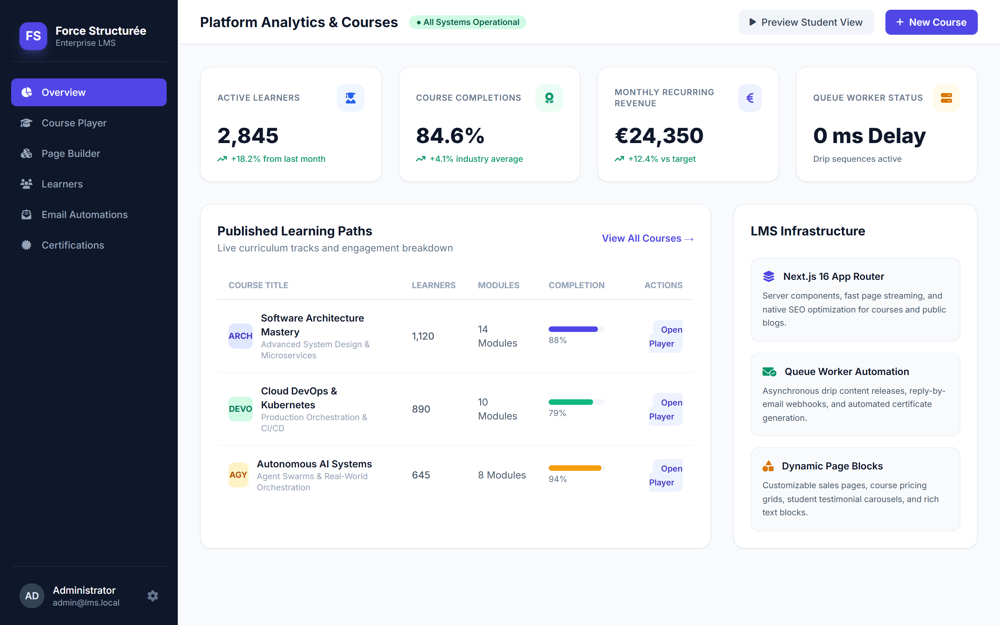
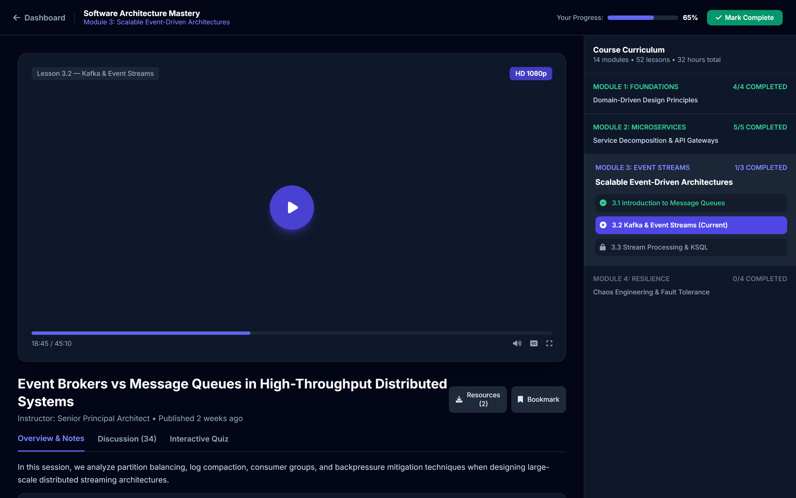
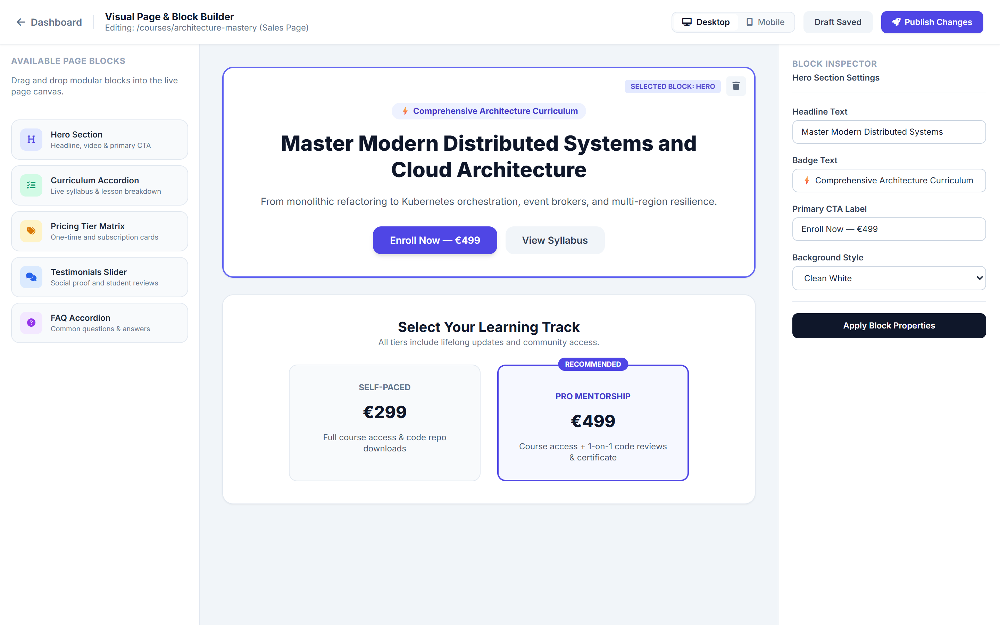

# Force Structurée LMS

[](https://nextjs.org/)
[](https://react.dev/)
[](https://www.typescriptlang.org/)
[](https://graphql.org/)
[](https://www.mongodb.com/)
[](https://tailwindcss.com/)
[](LICENSE.md)

Modern, open-source Learning Management System (LMS) designed for online course delivery, digital product distribution, interactive video learning, and student community management.

Force Structurée LMS unifies an optimized public storefront, an immersive student learning experience, an exhaustive administration dashboard, digital curriculum management, integrated billing/checkout, and asynchronous worker queues for automated email delivery and sequenced learning journeys.

---

## Screenshots

| Instructor & Admin Analytics Dashboard |
| :---: |
|  |

| Student Video Player & Curriculum Sidebar | Modular Visual Page Block Builder |
| :---: | :---: |
|  |  |

---

## Monorepo Architecture

The repository is structured as a high-performance monorepo managed with `pnpm`:

### Applications (`apps/`)

- **`apps/web`**: Main Next.js application (App Router, React 19, Tailwind CSS). Includes the learner portal, admin dashboard, GraphQL API, and REST/OpenAPI endpoints.
- **`apps/queue`**: Background worker service handling asynchronous tasks (automated email sequences, drip content release, notifications, and scheduled background jobs).
- **`apps/docs-new`**: Modern documentation website powered by Next.js and Fumadocs.
- **`demo/`**: Offline interactive demo showcase featuring the administration dashboard, course player, and page block builder.

### Shared Packages & Libraries (`packages/`)

- **`packages/common-models`** & **`packages/orm-models`**: Domain data models and MongoDB persistence schemas.
- **`packages/common-logic`**: Shared business logic, permission rules, and resolvers.
- **`packages/components-library`** & **`packages/page-primitives`**: Design system and reusable UI components.
- **`packages/page-blocks`**: Dynamic building blocks for page layout customization (hero, syllabus, pricing, FAQ).
- **`packages/text-editor`** & **`packages/email-editor`**: Rich-text and email template editors.
- **`packages/utils`**: Cross-cutting utilities (data formatting, security sanitization, HTTP query builders).

### Deployment Infrastructure (`deploiement-force-structuree/`)

- Production-ready Docker Compose orchestration featuring Caddy reverse proxy (automatic TLS/HTTPS), MongoDB database service, and maintenance automation scripts.

---

## How to Install & Configure

### Prerequisites

- [Node.js](https://nodejs.org/) (v20 or v22+ LTS recommended)
- [pnpm](https://pnpm.io/) (v10+ recommended)
- [MongoDB](https://www.mongodb.com/) (local daemon or MongoDB Atlas URI)

### Step 1: Clone the Repository

```bash
git clone https://github.com/Emincanozen/force-structuree-lms.git
cd force-structuree-lms
```

### Step 2: Install Workspace Dependencies

```bash
pnpm install
```

### Step 3: Build Shared Packages

```bash
pnpm --filter './packages/**' -r run build
```

### Step 4: Configure Environment Variables

1. **Web Application Environment:**
   ```bash
   cp apps/web/.env.example apps/web/.env
   ```
   Key environment variables:
   - `DB_CONNECTION_STRING`: MongoDB connection URI (e.g. `mongodb://localhost:27017/courselit`)
   - `AUTH_SECRET`: Random 32+ character authentication secret
   - `SUPER_ADMIN_EMAIL`: Email initialized as the primary administrator
   - `QUEUE_SERVER`: URL of the queue background service (`http://localhost:4000`)

2. **Queue Background Worker Environment:**
   ```bash
   cp apps/queue/.env.example apps/queue/.env
   ```

---

## How to Use

### Running Development Servers

1. **Start the Web Application (Next.js):**
   ```bash
   pnpm --filter @courselit/web dev
   ```
   The application will start on `http://localhost:3000`.

2. **Start the Background Queue Worker:**
   ```bash
   pnpm --filter @courselit/queue dev
   ```
   The worker listens on `http://localhost:4000` to process emails, drip schedules, and certificates.

3. **Running the Interactive Static Demo (Offline Preview):**
   To preview the dashboard, course player, and page builder without spinning up MongoDB:
   ```bash
   node ../serve.mjs demo 3112
   ```
   Open `http://localhost:3112` in your browser.

---

## How to Create / Customize

### 1. Creating a New Course & Curriculum

1. Log into the administration dashboard at `/dashboard`.
2. Navigate to **Courses** &rarr; **New Course**.
3. Fill in the course details:
   - **Title & Subtitle:** Displayed on sales pages and student cards.
   - **Pricing:** Set free access, one-off purchase, or monthly subscription.
   - **Curriculum Builder:** Add modules (sections) and individual lessons (Video, Audio, Rich Markdown, Quizzes, or File Downloads).
4. Configure **Drip Settings** to release lessons on a scheduled interval (e.g., 1 module every 7 days).
5. Toggle status to **Published**.

### 2. Creating Custom Page Blocks

Force Structurée uses a modular page block architecture (`packages/page-blocks`):

1. **Create a new block component:**
   In `packages/page-blocks/src/blocks/my-custom-block.tsx`:

   ```tsx
   import React from 'react';
   import type { BlockProps } from '@courselit/page-models';

   export interface MyCustomBlockConfig {
     title: string;
     highlightText: string;
   }

   export const MyCustomBlock = ({ config }: BlockProps<MyCustomBlockConfig>) => {
     return (
       <section className="py-16 bg-slate-50 border-y border-slate-200">
         <div className="max-w-4xl mx-auto px-6 text-center">
           <h2 className="text-3xl font-extrabold text-slate-900">{config.title}</h2>
           <p className="mt-3 text-indigo-600 font-semibold">{config.highlightText}</p>
         </div>
       </section>
     );
   };
   ```

2. **Register the block in the block registry:**
   Add your block to `packages/page-blocks/src/registry.ts` with its JSON schema and property controls. It will immediately be available in the visual page editor.

### 3. Customizing Themes & Design System

- **Tailwind Tokens:** Base styles, brand colors, and typography are configured in `apps/web/tailwind.config.ts`.
- **Reusable Primitives:** Buttons, inputs, dialogs, and layout shells are maintained in `packages/components-library`.

---

## Testing & Quality Assurance

```bash
# Run code linting across all packages
pnpm lint

# Format code with Prettier
pnpm prettier

# Run automated unit and integration tests
pnpm test
```

---

## License

This project is open-source software licensed under the [MIT License](LICENSE.md).
